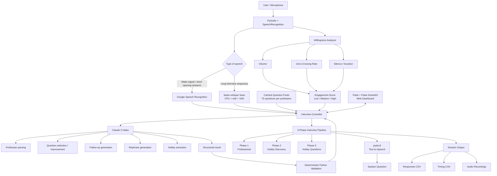

# RoboJEC

A voice-based personality interview system that conducts adaptive, conversational interviews using speech recognition and the Claude API.

Built as part of the research published at **IEEE ICCCMLA 2025** — *LLM-based Personality-Oriented Conversational AI System*.

---

## What it does

RoboJEC listens for a wake signal, identifies who it's speaking with through a short conversation, and then conducts a structured personality interview across three phases:

1. **Professional phase** — 6 questions about the person's work or studies, adapted to their field and experience level
2. **Hobby discovery** — asks what the person enjoys outside their professional life
3. **Hobby phase** — 3 questions exploring their interests in depth

Questions are generated by Claude and adapted in real time based on what the person has already said. If someone doesn't understand a question, they can say so and the system will rephrase it. If they want it repeated, it repeats it exactly.

---

## How it works

```
python main.py
```

RoboJEC listens silently for 5 seconds. If it hears something, the interview begins. If nothing is heard, it exits.

The opening sequence collects the person's name, profession (with clarification if the role is vague), and years of experience. A consent disclaimer is read before any audio is recorded.

After the interview, responses are saved to CSV and JSON, along with timing data measuring the gap between a person finishing their answer and the system asking the next question.

---

## System Architecture



RoboJEC separates flexible language understanding from deterministic control.

- **Google Speech Recognition** handles short opening utterances.
- **faster-whisper** transcribes longer interview responses.
- **Claude** handles language-heavy tasks such as profession parsing, question selection, follow-ups and rephrasing.
- **Python rules** validate decisions that need consistent behaviour.
- An audio-based **willingness heuristic** influences which question pool is used.
- The interview controller coordinates all three phases and saves responses and timing information.

---

## Tech stack

- **Speech recognition** — [faster-whisper](https://github.com/SYSTRAN/faster-whisper) (`base` model, CPU) for interview responses; Google SR for short utterances
- **LLM** — Claude 3 Haiku via the Anthropic API for question generation, profession recognition, and conversational decisions
- **TTS** — pyttsx3 (offline)
- **Audio** — PyAudio + SpeechRecognition for recording
- **NLP** — NLTK + spaCy for name extraction and hobby parsing

---


## Setup

**Requirements:** Python 3.11, a working microphone, Anthropic API key

```bash
# clone and enter
git clone https://github.com/dixitdevarshi/RoboJEC.git
cd RoboJEC

# create virtual environment
python -m venv venv
venv\Scripts\activate        # Windows
# source venv/bin/activate   # Linux/Mac

# install dependencies
pip install -r requirements.txt
python -m spacy download en_core_web_sm

# set up environment
copy .env.example .env       # Windows
# cp .env.example .env       # Linux/Mac
# then add your Anthropic API key inside .env
```

**Find your microphone device index:**
```bash
python -c "import speech_recognition as sr; [print(i, sr.Microphone.list_microphone_names()[i]) for i in range(len(sr.Microphone.list_microphone_names()))]"
```

Set the correct index in `.env` or `config.py` (`MIC_DEVICE_INDEX`).

**Run:**
```bash
python main.py
```

---

## Key design decisions

**No hardcoded question sequences.** From question 2 onward, Claude sees the conversation history and decides whether to use a candidate question from the pool or generate a better one given what's already been discussed.

**Profession recognition is Claude-first.** Rather than matching against a fixed taxonomy, the system sends the person's raw answer to Claude and gets back structured data — context (student/professional), field, role, whether clarification is needed. A rule-based fallback handles API failures.

**Willingness adapts question difficulty.** After each response, audio features (volume, zero-crossing rate, silence ratio) produce a 0–100 engagement score. Questions are drawn from low/medium/high pools accordingly.

**Timing is measured precisely.** The system tracks the gap from when transcription completes to when the first byte of the next question's audio plays — not just wall clock time. This is reported in `timing_data.csv` per session.

---


## Research

This project was developed as part of undergraduate research at Jabalpur Engineering College.

**Project guide:** Dr. Agya Mishra

---

## Authors

Sanskriti Jain
Devarshi Dixit


